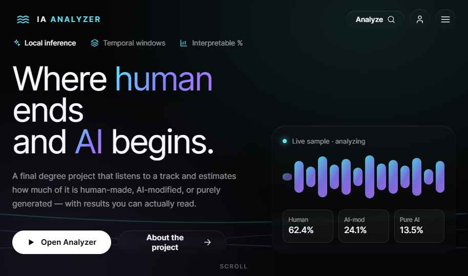
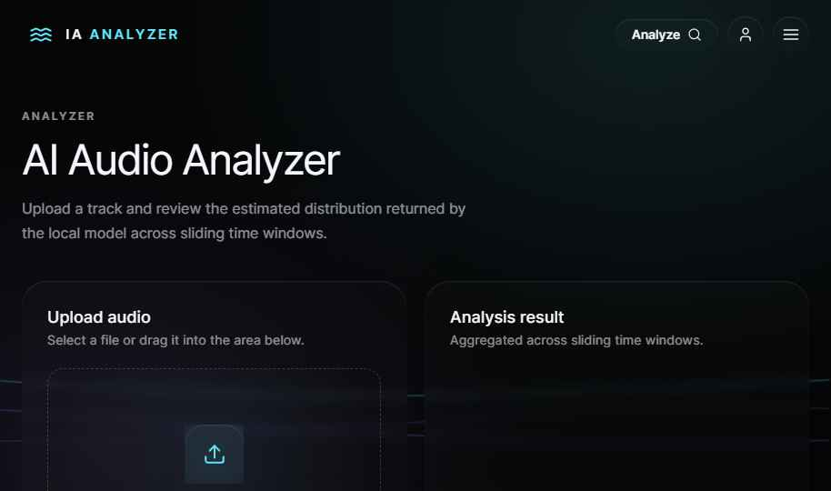
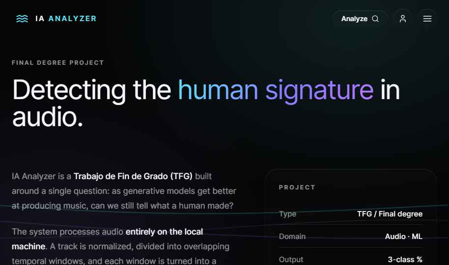

# AI Song Checker

Detects whether a song is **human-made or AI-generated** from its audio alone.

Final Degree Project (TFG) — Universidad Camilo José Cela, 2025/2026.



## How it works

1. The uploaded track is decoded with ffmpeg, converted to mono and resampled to 24 kHz.
2. Audio is split into fixed-length chunks and each one is encoded with **MERT-v1-95M**
   (Music Encoder Representations from Transformers).
3. Mean-pooled embeddings go through a small **MLP classification head** (`human` vs `pure_ai`).
4. Chunk predictions are aggregated and calibrated with **temperature scaling** to produce
   a trustworthy confidence score.


## Tech stack

| Layer     | Technologies                                        |
|-----------|-----------------------------------------------------|
| Model     | PyTorch, MERT (vendored architecture), torchaudio, librosa |
| Backend   | FastAPI, Uvicorn                                    |
| Frontend  | React 18, Vite, React Router, lucide-react          |
| Deploy    | Docker (multi-stage build)                          |

## Project structure

```
backend/
  app/
    main.py      # FastAPI app: /api/analyze, /api/health, serves the SPA
    infer.py     # Inference pipeline (chunking, aggregation, calibration)
    model.py     # MERT encoder + MLP head
    audio.py     # Audio decoding and preprocessing
    calibrate.py # Temperature-scaling utilities
    weights.py   # Downloads model.pt from GitHub Releases if missing
    mert/        # Vendored MERT-v1-95M architecture (no external downloads)
  weights/       # temperature.json (+ model.pt, downloaded on first run)
scripts/
  download_weights.py
training/
  dataset.py, augment.py, train.py, eval.py, baseline.py,
  temperature_scaling.py, export_onnx.py
frontend/react-src/   # React + Vite web app
Dockerfile            # Builds frontend and backend into a single image
```

## Running locally

Everything runs locally: the MERT architecture is included in the repo, so no
external model hub is needed. The trained weights (`backend/weights/model.pt`, ~380 MB)
exceed GitHub's file size limit, so they are published as a
[GitHub Release asset](https://github.com/jesusarranznavas/ai-song-checker/releases/tag/v1.0)
and downloaded automatically on first run (or manually with
`python scripts/download_weights.py`).

### With Docker

```bash
docker build -t ai-song-checker .
docker run -p 8000:8000 ai-song-checker
# open http://localhost:8000
```

### Manually

```bash
# Backend (requires ffmpeg)
pip install -r backend/requirements.txt
python scripts/download_weights.py   # optional, also done on first start
uvicorn backend.app.main:app --port 8000

# Frontend
cd frontend/react-src
npm install
npm run dev
```

## Training

Expected dataset layout:

```
data/
  train/{human,pure_ai}/*.wav|mp3
  val/{human,pure_ai}/...
  test/{human,pure_ai}/...
```

```bash
pip install -r backend/requirements.txt -r training/requirements.txt
# The encoder is initialised from backend/weights/model.pt by default;
# use --encoder_weights to start from the original MERT-v1-95M pytorch_model.bin instead.
python -m training.train --data_dir ./data --epochs 10
python -m training.eval --data_dir ./data
python -m training.temperature_scaling --data_dir ./data
```

## Screenshots

| Analyzer | About |
|----------|-------|
|  |  |

## Credits

The audio encoder is [MERT-v1-95M](https://arxiv.org/abs/2306.00107) by m-a-p
(CC BY-NC 4.0). Its model definition is vendored in `backend/app/mert/`.

## Author

**Jesús Arranz** — [GitHub](https://github.com/jesusarranznavas)
